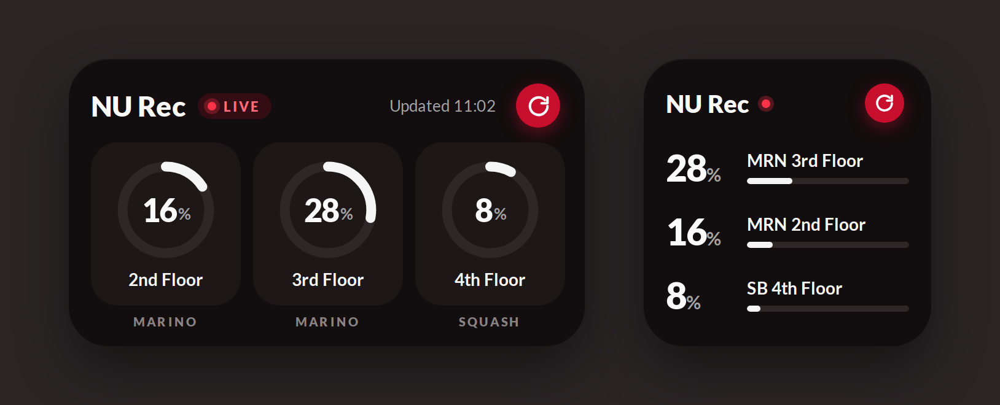

# NU Rec Widget

Android home-screen widget showing live occupancy for Marino (2nd Floor, 3rd Floor) and SquashBusters (4th Floor). Pulls from the public API.

<p align="center"></p>

## 1. Get the code

```bash
git clone <repo-url> nu-rec-widget
cd nu-rec-widget
```

## 2. Install the tools

You need JDK 17, the Android SDK, and adb.

### Windows (PowerShell)

```powershell
winget install Microsoft.OpenJDK.17
winget install Google.AndroidStudio
winget install Google.PlatformTools
```

Open Android Studio once and finish the setup wizard (it downloads the SDK and accepts the licenses). Then, in the repo folder:

```powershell
"sdk.dir=$($env:LOCALAPPDATA -replace '\\','\\')\\Android\\Sdk" | Out-File -Encoding ascii local.properties
```

Open a new PowerShell window so `java` and `adb` are on your PATH.

### macOS (Homebrew)

```bash
brew install openjdk@17
brew install --cask android-commandlinetools android-platform-tools
export JAVA_HOME="$(brew --prefix openjdk@17)"
sdkmanager --licenses
sdkmanager "platforms;android-37.2" "build-tools;37.0.0"
echo "sdk.dir=$(brew --prefix)/share/android-commandlinetools" > local.properties
```

### Linux (Debian/Ubuntu)

```bash
sudo apt install openjdk-17-jdk adb unzip curl
mkdir -p ~/Android/Sdk/cmdline-tools && cd ~/Android/Sdk/cmdline-tools
curl -LO https://dl.google.com/android/repository/commandlinetools-linux-16111833_latest.zip
unzip commandlinetools-linux-*_latest.zip && mv cmdline-tools latest && cd -
~/Android/Sdk/cmdline-tools/latest/bin/sdkmanager --licenses
~/Android/Sdk/cmdline-tools/latest/bin/sdkmanager "platforms;android-37.2" "build-tools;37.0.0"
echo "sdk.dir=$HOME/Android/Sdk" > local.properties
```

## 3. Build

Windows:

```powershell
.\gradlew.bat assembleDebug
```

macOS / Linux:

```bash
./gradlew assembleDebug
```

APK: `app/build/outputs/apk/debug/app-debug.apk`

## 4. Install on your phone

1. On the phone, open Settings, then About phone and tap Build number 7 times.
2. Open Settings, System, then Developer options and turn on USB debugging.
3. Plug the phone in and tap Allow on the prompt.
4. Check it's connected (it should be listed as `device`):

   ```bash
   adb devices
   ```

5. Install:

   ```bash
   adb install -r app/build/outputs/apk/debug/app-debug.apk
   ```

Without adb, copy the APK to the phone, open it, allow "Install unknown apps" when asked, tap Install.

## 5. Add the widget

Long-press the home screen, then select Widgets and NU Rec.
