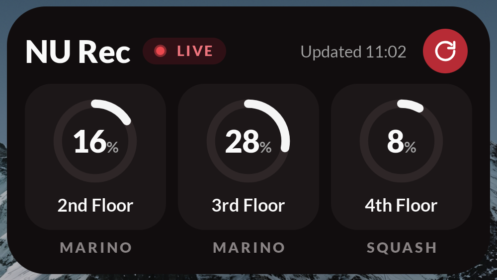
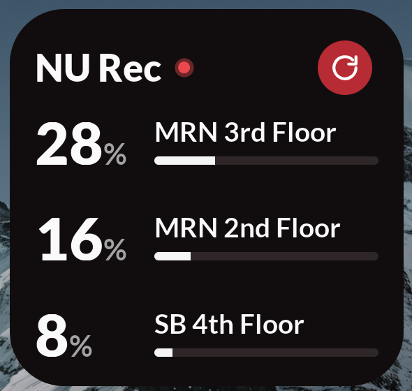

# NU Rec Widget

Android home-screen widget showing live occupancy for Marino (2nd Floor, 3rd Floor) and SquashBusters (4th Floor).

 

## Build

Needs JDK 17 and the Android SDK (`local.properties`: `sdk.dir=/path/to/Android/Sdk`).

```bash
./gradlew assembleDebug
```

APK: `app/build/outputs/apk/debug/app-debug.apk`

## Install

**With adb** (USB debugging on):

```bash
adb install -r app/build/outputs/apk/debug/app-debug.apk
```

**Without adb:** copy the APK to the phone, open it, allow "Install unknown apps" when asked, tap Install.

## Add the widget

Long-press the home screen → Widgets → NU Rec. Use 4×2 or 2×2.
